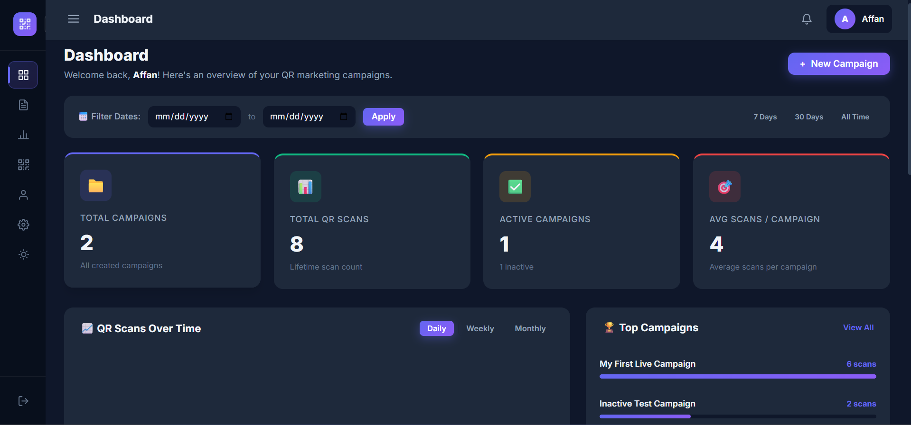
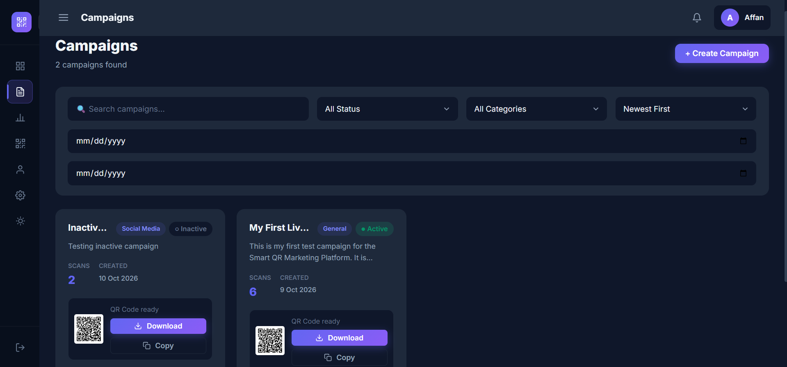

# Smart QR Marketing Platform

A web-based QR marketing platform that allows users to create marketing campaigns, generate customizable QR codes, track scans, and monitor campaign performance through an analytics dashboard.

## 🌐 Live Demo

[Visit Smart QR Marketing Platform](https://smart-qr-marketing-platform.vercel.app/)

## 📸 Project Screenshots

### 1. Dashboard

### 2. Campaign Management

### 3. Customizable QR Standee Designer

## ✨ Features

- User Signup and Login
- Create, Update, and Delete Campaigns
- QR Code Generation and Download
- QR Scan Tracking
- Analytics Dashboard
- Campaign Search and Status Filter
- Customizable QR Standee Designer
- Multiple QR Standee Sizes and Layout Options
- QR Standee Design Customization
- JWT Authentication
- User-wise Data Security

## 🛠️ Technologies Used

- **Frontend:** Next.js, React, Tailwind CSS
- **Backend:** Node.js, Express.js
- **Database:** MongoDB
- **Authentication:** JWT
- **QR Code:** QR Code Generation Library

## ⚙️ Project Setup

1. Clone this repository.
2. Install dependencies in the frontend and backend folders.
3. Configure environment variables.
4. Start the backend and frontend servers.

## 👨‍💻 Developer

**Manjoor Ahmad**
